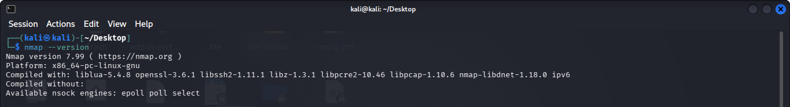
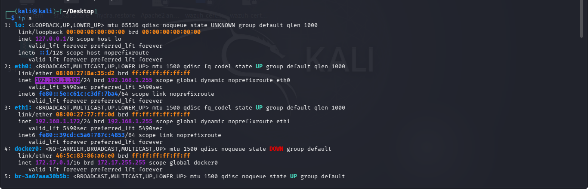
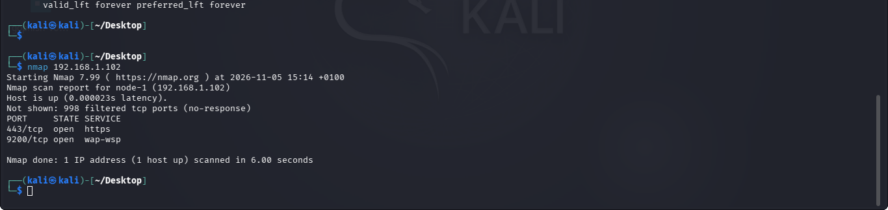
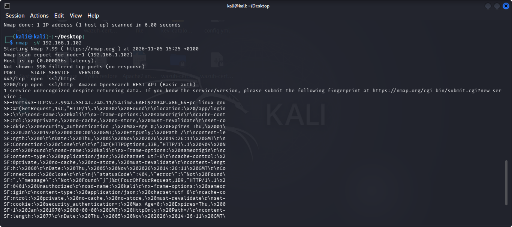
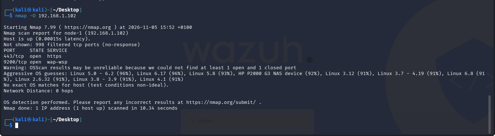

# Task 1: Basic Network Scanning with Nmap

## 1. Objective

Scan a machine I own with Nmap to identify its open ports, the services running on them, and its operating system. Then document the findings and assess the security risk of each open port.

## 2. What is Nmap?

Nmap (Network Mapper) is a free, open-source tool for network discovery and security auditing. It sends packets to a target and reads the replies. From those replies, it reports which ports are open, which services run on them, and which operating system the target likely uses. Security analysts, system administrators, and attackers all use it.

## 3. Why Network Scanning Matters

Every open port is a possible way into a system. An attacker starts by scanning to find those entry points. A defender who scans first can see the same picture and fix problems before an attacker uses them. Scanning also helps teams find services they did not know were running, confirm that firewall rules work, and keep an accurate record of what each system exposes.

## 4. Lab Environment

| Item | Detail |
|---|---|
| Scanner and target | Kali Linux virtual machine (VirtualBox), hostname `node-1` |
| Target IP | 192.168.1.102 |
| Nmap version | 7.99 |
| Date | 2026-11-05 |

I scanned my own virtual machine, which I own and control.

## 5. Installation

Kali Linux ships with Nmap pre-installed. On other Debian-based systems, install it with:

```bash
sudo apt install nmap
```

On my machine, the command reported that Nmap was already the newest version.

I then checked the installed version:

```bash
nmap --version
```



## 6. Lab Steps

### 6.1 Find the target IP

```bash
ip a
```

The target address is 192.168.1.102.



### 6.2 Basic scan

```bash
nmap 192.168.1.102
```

The scan found two open ports: 443 and 9200. The other 998 ports are filtered, which means a firewall drops the probes without replying.



### 6.3 Service version scan

```bash
nmap -sV 192.168.1.102
```

Port 9200 returned as the OpenSearch REST API with basic authentication. Nmap could not name the service on port 443, so I read the raw fingerprint in the output. It contained an `osd-name` header, a redirect to `/app/login`, and a `security_authentication` cookie. These point to OpenSearch Dashboards, the web interface for OpenSearch.



I confirmed this by opening `https://192.168.1.102` in the browser. The OpenSearch Dashboards login page loaded.


### 6.4 OS detection scan

```bash
sudo nmap -O 192.168.1.102
```

Nmap guessed Linux, with Linux 5.0 to 6.2 and Linux 6.17 both at 96%. It also warned that results may be unreliable because it found no closed port to compare against. One guess, an HP NAS device at 92%, is wrong. Incomplete fingerprints cause false guesses like this, so OS detection results need critical reading.



### 6.5 Save the results

```bash
nmap -sV -O 192.168.1.102 -oN nmap_scan_results.txt
```

I displayed the file to check its contents:

```bash
cat nmap_scan_results.txt
```

## 7. Findings

| Port | State | Service | What it does | Risk |
|---|---|---|---|---|
| 443/tcp | Open | OpenSearch Dashboards | Gives users a browser interface to search and visualise OpenSearch data | Medium |
| 9200/tcp | Open | OpenSearch REST API | Lets applications read and write OpenSearch data over HTTPS | Medium |
| 998 other ports | Filtered | None visible | A firewall blocks the probes | Low |

Operating system: Linux (best guess, limited accuracy).

The full scan output and my analysis are in [nmap_scan_results.txt](results/nmap_scan_results.txt).

## 8. Security Analysis

Both open services require a login, which is a good baseline. The main risk is weak authentication.

An attacker who finds these same ports does not need to break the software. They can guess passwords with automated tools that try thousands of common passwords in minutes. If one works, the attacker logs in as a normal user. Through port 9200, they can read, change, or delete the data stored in OpenSearch. In an organization, that data can include logs, customer records, and security alerts. An attacker can also delete logs to hide their tracks and use the access to move deeper into the network.

Recommended fixes:
- Use strong, unique passwords and change any defaults.
- Turn on multi-factor authentication where the software supports it.
- Limit which addresses can reach ports 443 and 9200 with firewall rules.
- Keep OpenSearch and OpenSearch Dashboards patched.
- Close any port that no business need requires.

## 9. Flag Reference

| Command or flag | What it does |
|---|---|
| `nmap [target]` | Runs a default scan of the 1,000 most common ports and reports each as open, closed, or filtered |
| `-sV` | Probes open ports to find the software and version behind each one |
| `-O` | Detects the operating system by comparing the target's replies to a database of known fingerprints. It needs sudo |
| `-oN [file]` | Saves the scan results to a text file in normal output format |

Port states:
- **Open:** a service is listening and accepts connections.
- **Closed:** the port is reachable, but no service listens on it.
- **Filtered:** a firewall or filter blocks the probes, so Nmap cannot tell whether the port is open.

## 10. Ethical Use

Scan only machines you own or have explicit written permission to scan. Unauthorised scanning can break the law and harm other people's systems. I ran every scan in this task against my own local virtual machine. I did not scan any external or production system.

## 11. Demo Video

[Watch the Task 1 demo video](https://drive.google.com/file/d/11knGV3XwfxZE8n9xFk7to70m0pAkji2d/view?usp=drivesdk)

## 12. Files in this Folder

| File | Description |
|---|---|
| [README.md](README.md) | This documentation |
| [results/nmap_scan_results.txt](results/nmap_scan_results.txt) | Raw scan output and port analysis |
| [screenshots/](screenshots/) | Screenshots of each step |

## 13. References

1. Nmap Reference Guide: https://nmap.org/book/man.html
2. Nmap official documentation: https://nmap.org/docs.html
3. Kali Linux: https://www.kali.org/get-kali
4. Netwrix, "How Insecure and Vulnerable Open Ports Pose Serious Security Risks": https://netwrix.com/en/resources/blog/open-ports-vulnerability-list/
5. Huawei, "High-Risk Ports: What Are the Common High-Risk Ports and How to Block Them": https://support.huawei.com/enterprise/en/doc/EDOC1100297670

## 14. Conclusion

The scan showed that my target exposes two services, OpenSearch Dashboards on port 443 and the OpenSearch REST API on port 9200. Both require authentication, and a firewall filters the other 998 ports. Scanning gave me a clear picture of the system's attack surface. The next step for a real organization would be to verify password strength, restrict access to these ports, and rescan after each change.
