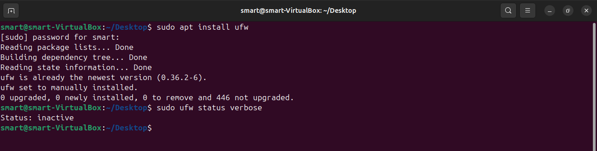
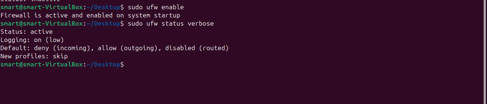
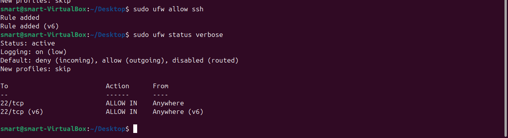
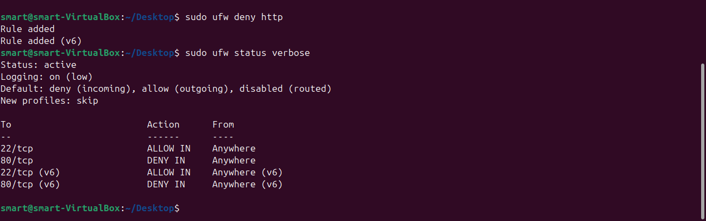
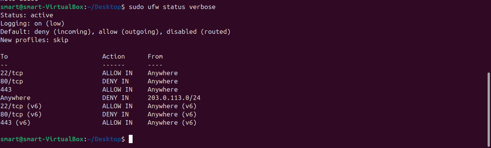
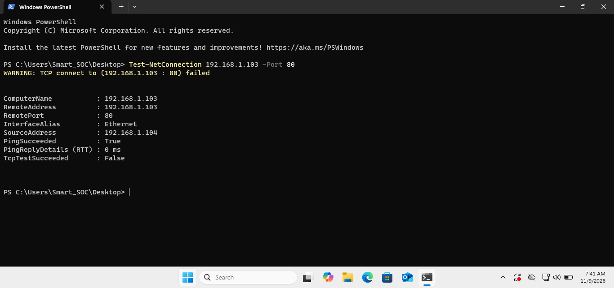
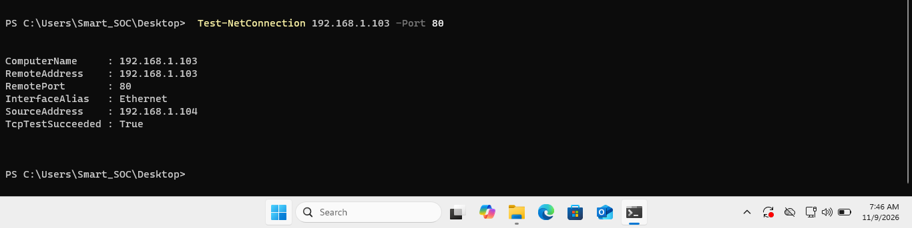
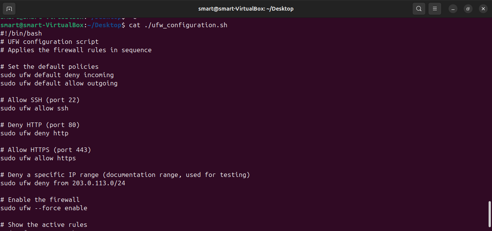

# Task 2: Basic Firewall Configuration with UFW

## 1. Objective

Set up and configure a firewall on a Linux system using UFW (Uncomplicated Firewall). Apply rules that allow and deny specific types of traffic, test that denied traffic is blocked, and automate the setup with a script.

## 2. What is a Firewall?

A firewall is a security control that sits between a system and the network. It checks each connection against a set of rules and decides whether to allow or block it. A firewall reduces the attack surface of a machine by closing every door that no one needs. UFW is a command-line front end for the Linux firewall that makes writing these rules simple.

## 3. Lab Environment

| Item | Detail |
|---|---|
| Firewall machine | Ubuntu virtual machine (VirtualBox), IP 192.168.1.103 |
| Test machine | Windows laptop, IP 192.168.1.104 |
| Test service | Apache2 web server listening on port 80 |
| Date | 2026-11-09 |

My Kali and Ubuntu virtual machines could not run at the same time on my laptop. I used my Windows laptop as the outside machine for the test instead.

## 4. Installation

UFW was already installed on my Ubuntu machine. To install it on a system without it, run:

```bash
sudo apt install ufw
```

The command reported that UFW was already the newest version.

## 5. Lab Steps

### 5.1 Check the starting state

```bash
sudo ufw status verbose
```

The firewall was inactive, so nothing filtered traffic.



### 5.2 Enable the firewall

```bash
sudo ufw enable
```

The default policy is to deny all incoming traffic and allow all outgoing traffic. Incoming connections stay blocked unless a rule allows them.



### 5.3 Allow SSH

```bash
sudo ufw allow ssh
```

This opens port 22 so the machine stays manageable remotely. UFW adds one rule for IPv4 and one for IPv6.



### 5.4 Deny HTTP

```bash
sudo ufw deny http
```

This blocks port 80, which carries unencrypted web traffic.



### 5.5 Add two more rules

```bash
sudo ufw allow https
sudo ufw deny from 203.0.113.0/24
```

The first rule allows port 443 for encrypted web traffic. The second blocks an entire IP range. I used 203.0.113.0/24, a range reserved for documentation and testing, so the rule cannot cut off a real device.

### 5.6 Verify the rules

```bash
sudo ufw status verbose
```



### 5.7 Test that denied traffic is blocked

A machine does not filter traffic it sends to itself, so I tested from a second machine. Apache2 was already listening on port 80 of the Ubuntu machine. From my Windows laptop, I ran this in PowerShell:

```powershell
Test-NetConnection 192.168.1.103 -Port 80
```

With the firewall on, the test failed. The ping succeeded, so the machine was reachable, but `TcpTestSucceeded` returned False.



To prove the firewall caused the block, I turned it off with `sudo ufw disable` and ran the same test. This time `TcpTestSucceeded` returned True.



I then turned the firewall back on with `sudo ufw enable`.

### 5.8 Automate with a script

The script below applies every rule in sequence. The same file is saved in this folder as [ufw_configuration.sh](ufw_configuration.sh).

```bash
#!/bin/bash
# UFW configuration script
# Applies the firewall rules in sequence

# Set the default policies
sudo ufw default deny incoming
sudo ufw default allow outgoing

# Allow SSH (port 22)
sudo ufw allow ssh

# Deny HTTP (port 80)
sudo ufw deny http

# Allow HTTPS (port 443)
sudo ufw allow https

# Deny a specific IP range (documentation range, used for testing)
sudo ufw deny from 203.0.113.0/24

# Enable the firewall
sudo ufw --force enable

# Show the active rules
sudo ufw status verbose
```

To use it, make it executable and run it:

```bash
chmod +x ufw_configuration.sh
./ufw_configuration.sh
```

To test the script, I wiped all rules with `sudo ufw --force reset` and then ran it. It rebuilt the same four rules.



## 6. Rules and Reasoning

| Rule | Command | What it achieves | Why I chose it |
|---|---|---|---|
| Default deny incoming | `sudo ufw default deny incoming` | Blocks all incoming traffic unless a rule allows it | A secure firewall starts closed and opens only what is needed |
| Allow SSH | `sudo ufw allow ssh` | Opens port 22 | Administrators need remote access to manage the machine |
| Deny HTTP | `sudo ufw deny http` | Blocks port 80 | HTTP traffic is unencrypted, so anyone on the network can read it |
| Allow HTTPS | `sudo ufw allow https` | Opens port 443 | Encrypted web traffic should still work |
| Deny IP range | `sudo ufw deny from 203.0.113.0/24` | Blocks every address in the range | Shows how to block a known bad network |

## 7. Security Analysis

The test showed that a firewall rule works only when you verify it. Apache listened on port 80 the whole time, yet the connection failed while the firewall was on. A service that is running is not the same as a service that is reachable. This is why a deny-by-default policy is the safer choice. If an administrator forgets about a service, the firewall still protects it.

The script makes the configuration repeatable. Every machine that runs it ends up with the same rules, which reduces human error.

## 8. Demo Video

[Watch the Task 2 demo video](https://drive.google.com/file/d/1sRktZGmmcY5dSqG_U3jLriW6ld8fBdYz/view?usp=drivesdk)

## 9. Files in this Folder

| File | Description |
|---|---|
| [README.md](README.md) | This documentation |
| [ufw_configuration.sh](ufw_configuration.sh) | Script that applies all rules in sequence |
| [screenshots/](screenshots/) | Screenshots of each step |

## 10. References

1. Ubuntu Community Help Wiki, UFW: https://help.ubuntu.com/community/UFW

## 11. Conclusion

I installed and enabled UFW, set a default deny policy, and added rules to allow SSH and HTTPS and to deny HTTP and one IP range. I proved the rules work by testing from a second machine, and I turned the setup into a script that rebuilds the firewall in seconds.
