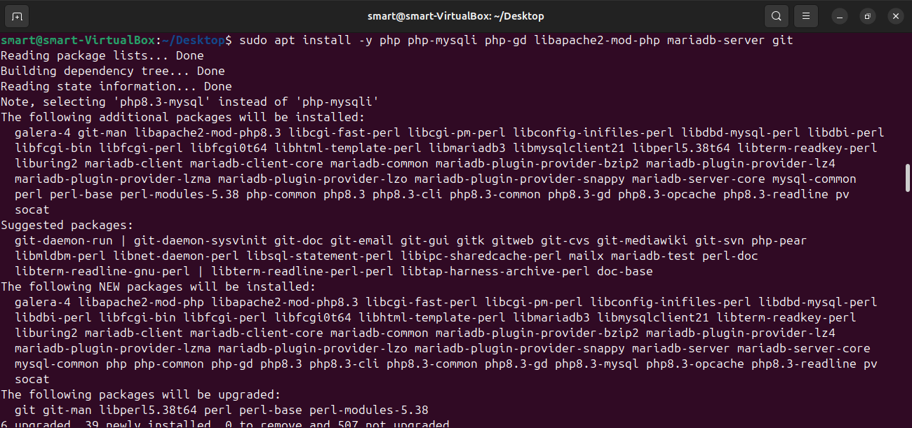
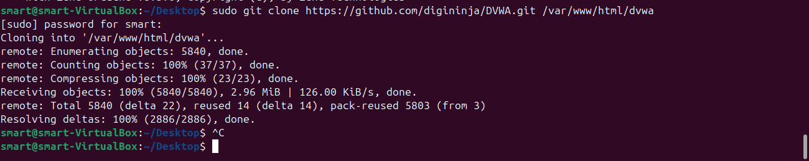
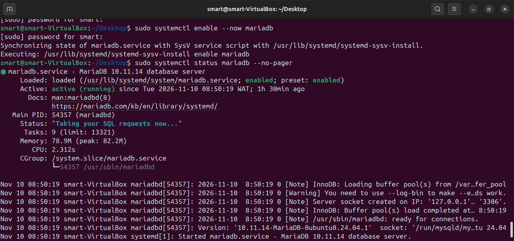
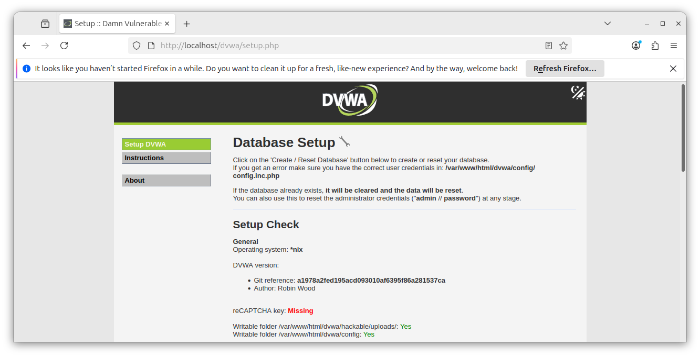
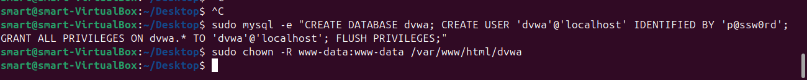
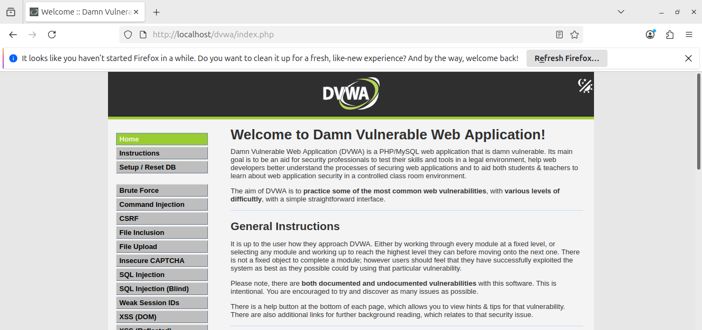
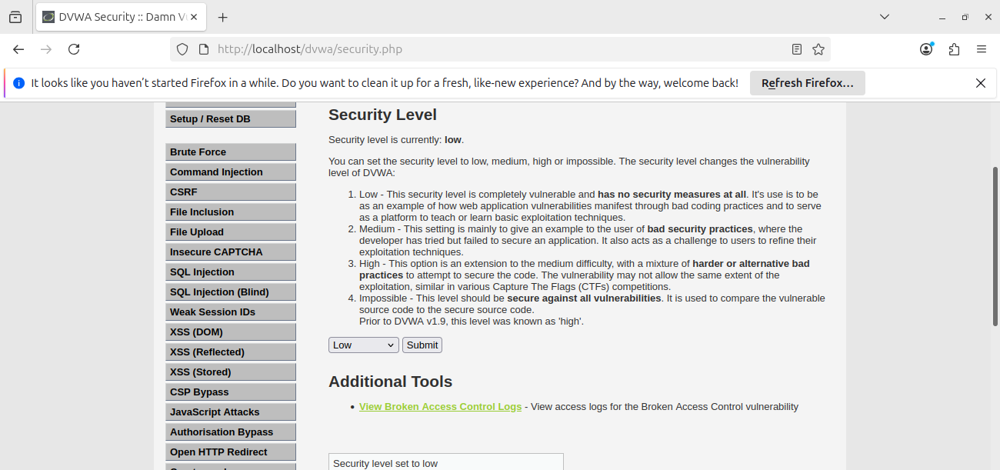
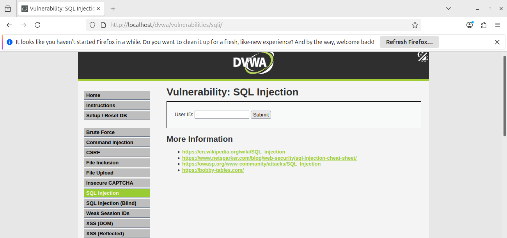
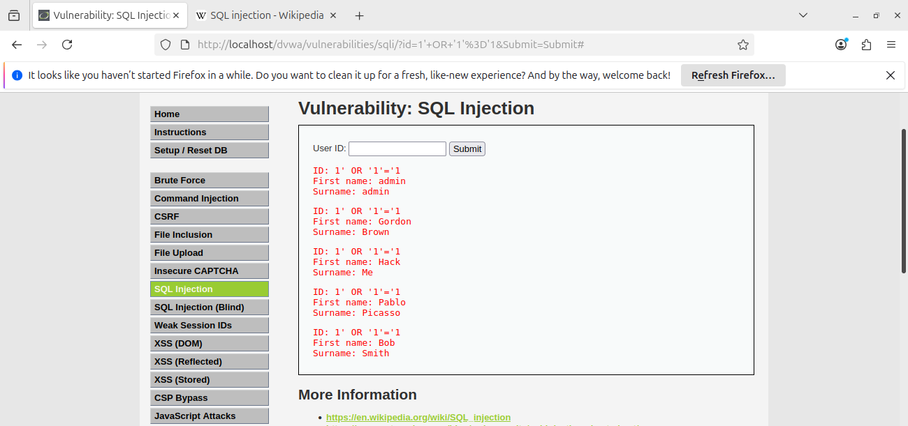
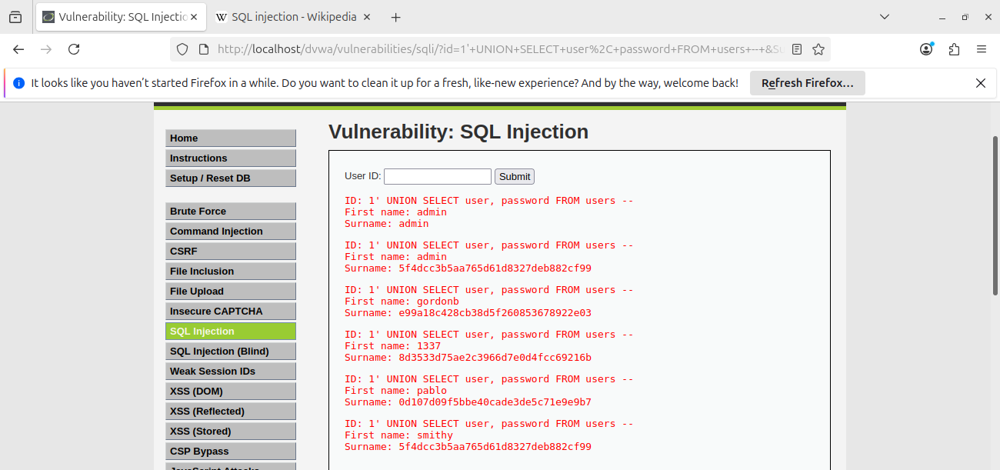

# Task 3: SQL Injection on DVWA (Low Security)

## 1. Objective

Demonstrate a classic SQL Injection vulnerability by exploiting the login form of DVWA (Damn Vulnerable Web Application) at its Low security setting. Document the attack mechanics, the exact data exposed by each payload, and the coding practices that prevent this vulnerability in production systems.

## 2. What is SQL Injection?

SQL injection is a vulnerability where an application builds a database query by combining a fixed command string with user input, without separating the two. When the input is not cleaned or escaped, an attacker can submit text that is interpreted as part of the SQL command itself rather than as a simple value. This lets the attacker read data they should not see, bypass authentication, modify records, or in some configurations delete entire tables.

SQL injection generally falls into three categories:

- **In-band injection**, where the attacker gets results directly in the application's response. This includes UNION-based attacks, where a second query is appended to the original and its results appear in the same output. Both payloads in this lab are in-band.
- **Blind injection**, where the application gives no visible output, so the attacker infers data one bit at a time by asking true-or-false questions and watching for differences in behavior or timing.
- **Out-of-band injection**, where results are sent through a separate channel, such as a DNS or HTTP request, usually when the first two methods are not possible.

SQL injection has consistently ranked among the most critical web application risks, including in the OWASP Top 10, because it directly threatens all three pillars of information security: confidentiality (data can be read), integrity (data can be changed), and availability (data or whole tables can be deleted).

## 3. Lab Environment

| Item | Detail |
|---|---|
| Host | Ubuntu virtual machine (VirtualBox), IP 192.168.1.103 |
| Stack | LAMP: Linux, Apache, MariaDB, PHP |
| Target application | DVWA (Damn Vulnerable Web Application) |
| Security level | Low |
| Browser | Firefox |
| Date | 2026-11-10 |

The brief allows XAMPP or LAMP. I used a LAMP stack on my Ubuntu VM, since Apache was already installed and running from an earlier task in this track.

## 4. Installation and Setup

### 4.1 Check for PHP

```bash
php -v
```

PHP was not installed on this machine. DVWA is a PHP application, so this step confirms the gap before fixing it.

### 4.2 Install the LAMP stack

Apache was already installed and running from an earlier task, so I did not reinstall it. I installed the remaining pieces of the stack in one command:

```bash
sudo apt install -y php php-mysqli php-gd libapache2-mod-php mariadb-server git
```

- `php`: the scripting language DVWA is written in. Apache hands incoming requests for `.php` files to the PHP interpreter, which runs the code and returns HTML.
- `php-mysqli`: the PHP extension that lets PHP code open a connection to a MySQL or MariaDB database and run queries. DVWA uses this extension for every database call, including the vulnerable one in this lab.
- `php-gd`: a graphics library PHP uses to generate images. DVWA uses it for the CAPTCHA image on its Insecure CAPTCHA module.
- `libapache2-mod-php`: the Apache module that connects Apache to the PHP interpreter, so requests for PHP pages are processed correctly instead of being served as plain text.
- `mariadb-server`: the database server that stores DVWA's data, including the `users` table targeted in this lab.
- `git`: a version control tool used here only to download DVWA's source code from its GitHub repository.



### 4.3 Download and configure DVWA

```bash
sudo git clone https://github.com/digininja/DVWA.git /var/www/html/dvwa
sudo cp /var/www/html/dvwa/config/config.inc.php.dist /var/www/html/dvwa/config/config.inc.php
```

`git clone` downloads the full DVWA source code into `/var/www/html/dvwa`, which is the document root Apache serves web content from by default. Any file placed there becomes reachable through a browser at `http://localhost/dvwa/`.

DVWA ships with a template configuration file, `config.inc.php.dist`, rather than a live one, so it cannot be run accidentally with default settings. The second command copies that template into `config.inc.php`, the file DVWA actually reads on every request. This file defines the database name, username, and password DVWA will use to connect to MariaDB, which must match the database I create in the next step.



### 4.4 Start the database

```bash
sudo systemctl enable --now mariadb
sudo systemctl status mariadb --no-pager
```

`enable --now` does two things at once: it starts the MariaDB service immediately, and it configures MariaDB to start automatically on every future boot, so the database is always available without a manual step. The status command confirms the service is `active (running)` before I try to connect to it.



### 4.5 Create the DVWA database and user

```bash
sudo mysql -e "CREATE DATABASE dvwa; CREATE USER 'dvwa'@'localhost' IDENTIFIED BY 'p@ssw0rd'; GRANT ALL PRIVILEGES ON dvwa.* TO 'dvwa'@'localhost'; FLUSH PRIVILEGES;"
```

This single command runs four SQL statements against the database server directly from the terminal:

1. `CREATE DATABASE dvwa` creates an empty database to hold DVWA's tables.
2. `CREATE USER` creates a database account named `dvwa`, separate from any Linux user account, with its own password.
3. `GRANT ALL PRIVILEGES ON dvwa.*` gives that account full control, but only over the `dvwa` database, not the whole server. This matches the credentials already set in `config.inc.php`.
4. `FLUSH PRIVILEGES` reloads MariaDB's permission tables so the new account takes effect immediately.

This password is intentionally simple because the database only accepts local connections in this lab. A production system would never use a weak password or grant a web application's database account more privilege than it strictly needs.

### 4.6 Fix file permissions

```bash
sudo chown -R www-data:www-data /var/www/html/dvwa
```

`www-data` is the Linux user account Apache runs as. By default, files downloaded with `git clone` are owned by whichever user ran the command, not by Apache. DVWA needs to write to certain folders at runtime, including its uploads directory and, during setup, its config file. Without this ownership change, those write attempts fail and the setup page reports folders as not writable.

### 4.7 Run the DVWA setup page

I opened `http://localhost/dvwa/setup.php`. This page runs a series of checks: it confirms the PHP version and extensions meet DVWA's requirements, and it confirms the folders DVWA needs to write to are writable by Apache. Once the checks pass, clicking **Create / Reset Database** runs DVWA's own setup script, which connects to the `dvwa` database using the credentials in `config.inc.php` and creates every table the application needs, including the `users` table.





### 4.8 Log in

I logged in at `http://localhost/dvwa/login.php` with DVWA's documented default credentials, username `admin` and password `password`. These credentials exist only for this training application and must never be reused anywhere else.



### 4.9 Set security level to Low

I opened **DVWA Security** and set the level to **Low**. DVWA's own documentation describes Low as having no security measures at all, intended to show how vulnerabilities manifest through bad coding practices. At this level, the SQL Injection module performs no input validation or escaping whatsoever, which is why the payloads in this lab succeed without any extra effort to bypass filters.



## 5. Exploiting the Vulnerability

The SQL Injection module takes a `User ID` value from the form and submits it to the server as a GET request, visible in the browser's address bar as `http://localhost/dvwa/vulnerabilities/sqli/?id=VALUE&Submit=Submit`. Whatever is typed into the field becomes the `id` parameter exactly as typed, with no cleaning applied before it reaches the database query at Low security.

### 5.1 Baseline test

I entered `1` in the User ID field. The underlying query is approximately:

```sql
SELECT first_name, last_name FROM users WHERE user_id = '1'
```

This returned exactly one row: admin, admin. This confirms the field behaves as intended when given a normal, expected value, which gives a clear comparison point for the injected results that follow.



### 5.2 Payload 1: Classic OR injection

**Payload:** `1' OR '1'='1`

Substituting this into the query above produces:

```sql
SELECT first_name, last_name FROM users WHERE user_id = '1' OR '1'='1'
```

The single quote in the payload closes the string literal the query expected to end after the `1`. Everything after it, `OR '1'='1'`, is then read as part of the SQL command rather than as data. Since `'1'='1'` evaluates to true for every row in the table regardless of its actual `user_id`, the `WHERE` clause matches every row in the `users` table. The database has no way to tell that this condition did not originate from DVWA's own code.

**Result:** All 5 users in the database were returned instead of one:
- admin, admin
- Gordon, Brown
- Hack, Me
- Pablo, Picasso
- Bob, Smith



### 5.3 Payload 2: UNION-based data extraction

**Payload:** `1' UNION SELECT user, password FROM users -- `

Substituting this produces:

```sql
SELECT first_name, last_name FROM users WHERE user_id = '1' UNION SELECT user, password FROM users -- '
```

`UNION SELECT` combines the output of a second, attacker-chosen query with the first, as long as both queries return the same number of columns. DVWA's query returns two columns, `first_name` and `last_name`, so my injected query also selects two columns, `user` and `password`, from the same `users` table. The trailing `-- ` marks everything after it as a SQL comment, which neutralizes the final quote mark DVWA's own code would otherwise add, preventing a syntax error.

**Result:** Every username and password hash stored in the database was returned in place of names:
- admin : 5f4dcc3b5aa765d61d8327deb882cf99
- gordonb : e99a18c428cb38d5f260853678922e03
- 1337 : 8d3533d75ae2c3966d7e0d4fcc69216b
- pablo : 0d107d09f5bbe40cade3de5c71e9e9b7
- smithy : 5f4dcc3b5aa765d61d8327deb882cf99



Full payload details and query breakdowns are also logged in [sql_injection_notes.md](sql_injection_notes.md).

## 6. Findings

| Finding ID | Payload | Data Exposed | Severity |
|---|---|---|---|
| F-01 | `1' OR '1'='1` | Full name list of all 5 users in the database, bypassing the intended single-record lookup | High |
| F-02 | `1' UNION SELECT user, password FROM users -- ` | Every username and password hash, including the administrator account | Critical |

F-02 is rated Critical rather than High because it exposes credentials rather than only names. A working credential, even as a hash, is a direct path toward full account takeover, while F-01 exposes data that is sensitive but not directly usable to gain access.

## 7. Security Analysis

This single, unvalidated input field broke all three pillars of security for the affected data:

- **Confidentiality** was broken because an outside user retrieved the complete user table, including administrator credentials, through a field intended to return one name.
- **Integrity** is also at risk in a real system, since the same injection technique that reads data with `SELECT` can, depending on the database account's privileges, also be used with `INSERT`, `UPDATE`, or `DELETE` statements to change or destroy records.
- **Availability** could be affected if an attacker used a similar unguarded field to run resource-intensive queries or to drop tables outright.

The password hashes recovered in F-02 use MD5, a hashing algorithm that was never designed to resist modern cracking hardware. MD5 hashes of common passwords are solved almost instantly using precomputed lookup tables, so an attacker does not need to break the hashing algorithm itself, only to check the hash against a table of already-known values. The hash `5f4dcc3b5aa765d61d8327deb882cf99` is the publicly known MD5 hash of the word "password," which is also DVWA's own documented default. In a real breach, an attacker who extracted this table would likely recover several working passwords within minutes, then use them to log in directly or to try the same passwords against other services the same users may have reused them on.

## 8. Remediation

### 8.1 Parameterised queries (the primary fix)

The vulnerability exists because DVWA builds its SQL query by concatenating user input directly into the command string:

```php
$id = $_REQUEST['id'];
$query = "SELECT first_name, last_name FROM users WHERE user_id = '$id'";
$result = mysqli_query($conn, $query);
```

The fix is to use parameterised queries, also called prepared statements. The query's structure is defined once, with a placeholder marking where user input belongs, and the actual input is sent to the database separately from the command:

```php
$id = $_REQUEST['id'];
$stmt = $conn->prepare("SELECT first_name, last_name FROM users WHERE user_id = ?");
$stmt->bind_param("s", $id);
$stmt->execute();
$result = $stmt->get_result();
```

With this approach, the database driver sends the query structure and the user's input as two separate pieces of information. The database treats the input strictly as a value to search for, never as part of the command. A quote mark or the word `OR` inside the input has no special meaning and cannot alter what the query does.

### 8.2 Additional defenses

Parameterised queries alone would stop this specific attack, but a production system benefits from layered defenses:

- **Least privilege database accounts.** The application's database account should only have permission to perform the operations it actually needs. A login lookup, for example, needs no permission to delete tables.
- **Input validation.** Fields expecting a number, like this User ID field, should reject anything that is not a valid number before the input ever reaches a query.
- **Strong password hashing.** Passwords should be hashed with a modern, slow algorithm designed for this purpose, such as bcrypt or Argon2, rather than a fast general-purpose hash like MD5.
- **Generic error messages.** Database errors shown to users can reveal table or column names that help an attacker refine further attacks, so detailed errors should be logged internally and replaced with a generic message for the user.
- **A web application firewall (WAF).** A WAF can detect and block many common injection patterns as an additional layer, though it should never be the only defense, since attackers regularly find ways around filter-based protection.

## 9. Ethical Use

This exercise was performed only on DVWA running locally on my own machine, which I own and control. I did not attempt SQL injection, or any other attack technique, on a real website, production system, or any system I do not have explicit permission to test. Unauthorized testing of this kind is illegal in most jurisdictions regardless of intent.

## 10. Demo Video

[Watch the Task 3 demo video](https://drive.google.com/file/d/1VnmAXxBXT4TBnzmmQ7bXksEq8fxdPUAQ/view?usp=drivesdk)

## 11. Files in this Folder

| File | Description |
|---|---|
| [README.md](README.md) | This documentation |
| [sql_injection_notes.md](sql_injection_notes.md) | Payload log, query breakdowns, and raw results |
| [screenshots/](screenshots/) | Screenshots of each step of the lab |

## 12. References

1. PortSwigger Web Security Academy, SQL Injection: https://portswigger.net/web-security/sql-injection
2. OWASP, SQL Injection: https://owasp.org/www-community/attacks/SQL_Injection

## 13. Conclusion

I installed DVWA on a LAMP stack and set its security level to Low to demonstrate SQL injection in a controlled environment. A classic OR-based payload bypassed the form's intended logic and returned every user's name instead of one. A UNION-based payload went further and extracted the entire credential table, including the administrator's password hash. Both attacks succeeded because the application trusted user input as part of its database command rather than treating it as plain data. Parameterised queries close this gap by separating the query's structure from user-supplied values, and should be combined with least-privilege database accounts, input validation, strong password hashing, and generic error messages for defense in depth.
